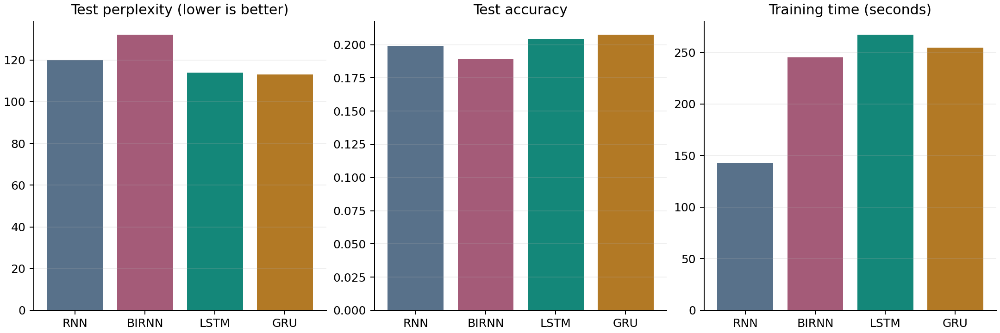
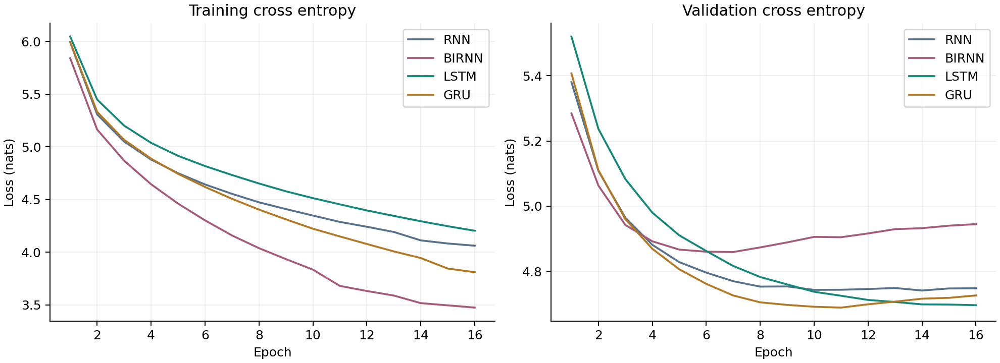
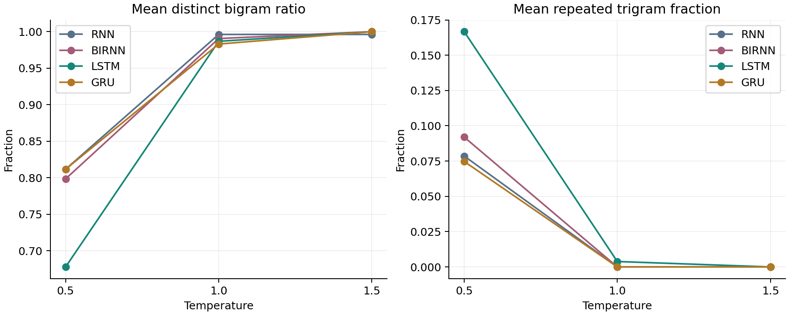

# AuditScribe experimental results

## Experimental conditions

All four models use 136,015 training windows, 16 epochs, batch size 512 and training seed 42. Each evaluation split contains 10,000 fixed windows. Checkpoints are selected by minimum validation loss. Full settings are recorded in results/config.json.

## Quantitative comparison

| Model | Parameters | Epoch | Validation loss | Test loss | Perplexity | Accuracy | Known-target accuracy | Lexical-word accuracy | Train seconds |
|---|---:|---:|---:|---:|---:|---:|---:|---:|---:|
| RNN | 659,552 | 14 | 4.7416 | 4.7873 | 119.97 | 19.89% | 20.26% | 17.87% | 142.7 |
| BIRNN | 1,059,104 | 7 | 4.8595 | 4.8832 | 132.06 | 18.90% | 19.19% | 16.57% | 245.2 |
| LSTM | 706,208 | 16 | 4.6967 | 4.7365 | 114.03 | 20.43% | 20.75% | 18.20% | 267.1 |
| GRU | 690,656 | 11 | 4.6892 | 4.7279 | 113.06 | 20.74% | 20.87% | 18.32% | 254.4 |

The smoothed unigram baseline achieves loss 5.8556, perplexity 349.19 and accuracy 7.18%. It is fitted only to training-target counts.

Primary accuracy includes punctuation and unknown tokens. Known-target accuracy excludes unknown targets; lexical-word accuracy excludes unknown targets and punctuation. Training time excludes validation and sampling. Fit wall time is reported separately in metrics.csv. CPU timings depend on hardware and system load.

## Learning behaviour

RNN, Bidirectional RNN and GRU reach their selected validation minima before the final epoch, while LSTM selects epoch 16. Validation-loss scheduling reduces the learning rate when improvement stalls. The stronger divergence of training and validation loss in Bidirectional RNN is consistent with overfitting. Its larger parameter count must be considered when comparing architectures.

## Sampling temperature analysis

Three identical prompts across all four models, three temperatures and three generation seeds produce 108 continuations of 60 tokens. Values below average the nine outputs per model/temperature pair.

| Model | Temperature | Samples | Distinct unigram | Distinct bigram | Repeated trigram |
|---|---:|---:|---:|---:|---:|
| RNN | 0.5 | 9 | 0.517 | 0.812 | 0.079 |
| RNN | 1.0 | 9 | 0.791 | 0.996 | 0.000 |
| RNN | 1.5 | 9 | 0.907 | 0.996 | 0.000 |
| BIRNN | 0.5 | 9 | 0.504 | 0.798 | 0.092 |
| BIRNN | 1.0 | 9 | 0.761 | 0.991 | 0.000 |
| BIRNN | 1.5 | 9 | 0.904 | 1.000 | 0.000 |
| LSTM | 0.5 | 9 | 0.402 | 0.678 | 0.167 |
| LSTM | 1.0 | 9 | 0.770 | 0.987 | 0.004 |
| LSTM | 1.5 | 9 | 0.893 | 1.000 | 0.000 |
| GRU | 0.5 | 9 | 0.502 | 0.812 | 0.075 |
| GRU | 1.0 | 9 | 0.754 | 0.983 | 0.000 |
| GRU | 1.5 | 9 | 0.917 | 1.000 | 0.000 |

Distinct-n divides the number of unique generated n-grams by all generated n-grams. Repeated-trigram fraction equals one minus distinct-3. Prompts are excluded. Lexical diversity is not a semantic quality score.

## Qualitative comparison

The [qualitative analysis](docs/qualitative_analysis.md) compares coherence, diversity, contextual consistency and repetition across all four models. [All generated text](results/generated_samples.txt) is available without editing. Low temperatures retain more recognizable phrases but repeat templates; high temperatures increase diversity while weakening syntax and topic consistency.

## Conclusion

**GRU is the best-performing model in this experiment**, based on validation selection and the final test comparison. Its low-temperature generation diagnostics support its selection, but none of the models reliably produces factually correct audit reports. The small GRU/LSTM gap and single training seed limit generalization beyond this experiment.
